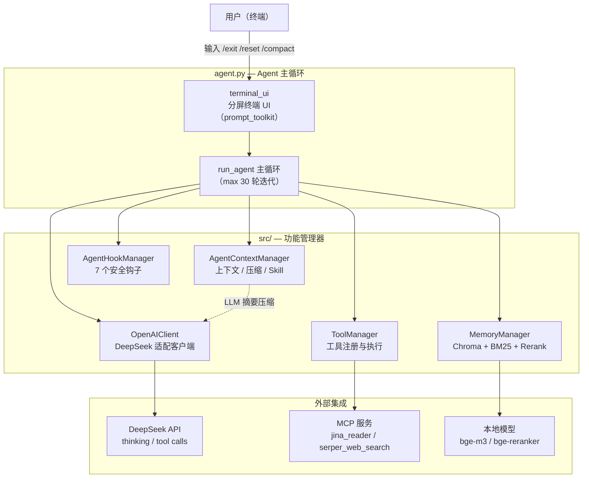
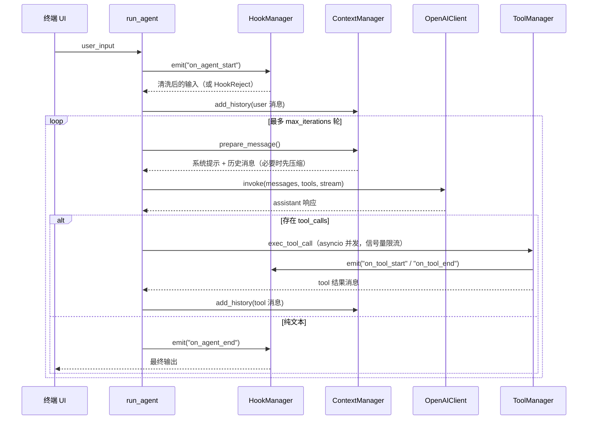

# CompactAgent

一个纯 Python 实现的模块化交互式 Agent 框架。麻雀虽小五脏俱全，内置上下文管理、分层记忆系统、安全护栏与 MCP 工具生态。

## 目录

- [项目概览](#项目概览)
- [运行说明](#运行说明)
  - [环境依赖](#环境依赖)
  - [快速启动](#快速启动)
  - [交互命令](#交互命令)
  - [可配置项](#可配置项)
- [架构设计](#架构设计)
  - [整体架构](#整体架构)
  - [Agent 主循环](#agent-主循环)
  - [上下文压缩策略](#上下文压缩策略)
  - [Skill 渐进式披露](#skill-渐进式披露)
  - [工具管理](#工具管理)
    - [内置工具](#内置工具)
    - [Agent 工具](#agent-工具)
    - [MCP 工具](#mcp-工具)
  - [记忆系统](#记忆系统)
  - [Hook 管道](#hook-管道)

## 项目概览

CompactAgent 是一个单进程、事件循环驱动的 Agent 框架，核心目标：

- **长任务可控**：按消息数 / token 比例自动压缩历史对话，把超出上下文窗口的旧轮次折叠为 LLM 摘要；
- **技能按需加载**：Skill 分三层渐进式披露（元数据 → 完整指令 → 参考资源），避免系统提示过长；
- **可记忆**：短期会话记忆与长期记忆分离存储，混合检索（向量 + BM25）+ 重排序，并支持基于 TTL 的遗忘与整合；
- **安全执行**：所有用户输入、工具调用、最终输出都会经过可插拔 Hook 管道，支持敏感信息脱敏、工具白名单、路径沙箱与人工审批；
- **生态开放**：工具可由普通 Python 函数自动生成 OpenAI Function Calling Schema，也可挂载外部 MCP 服务。

典型使用场景：交互式代码助手、命令行自动化 Agent、MCP 工具集成的快速原型、Agent 框架教学参考。

## 运行说明

### 环境依赖

Python 3.10+，本项目不依赖内部的其他服务，但启动 / 运行时需要以下**外部服务与资源**：

| 依赖 | 用途 | 配置位置 |
| --- | --- | --- |
| DeepSeek API（OpenAI 兼容） | 主推理、摘要与记忆提炼 | `config.json` → `llm`；API Key 读取环境变量 `DEEPSEEK_API_KEY` |
| Jina Reader API (`r.jina.ai`) | 网页正文提取 | MCP 服务 `jina_reader` 的 `JINA_API_KEY` |
| Serper 搜索 API (`google.serper.dev`) | 联网搜索 | MCP 服务 `serper_web_search` 请求头 `X-API-KEY` |
| HuggingFace 模型仓库 | 首次运行下载 `BAAI/bge-m3`、`BAAI/bge-reranker-base` | `config.json` → `memory` |

**注意**：Windows 下需在 `cmd.exe` 或 Windows Terminal 中运行（依赖控制台屏幕缓冲，不兼容部分 IDE 内置终端）

### 快速启动

先设置 DeepSeek API Key（`config.json` 中的 `llm.api_key` 留空即可）：

```powershell
# PowerShell
$env:DEEPSEEK_API_KEY = "sk-..."
```

```bat
:: cmd.exe
set DEEPSEEK_API_KEY=sk-...
```

```bash
# bash / zsh
export DEEPSEEK_API_KEY=sk-...
```

然后启动：

```bash
python agent.py
```

启动流程：读取 `config.json` → 启动终端 UI（后台线程）→ 初始化 `OpenAIClient` / `AgentContextManager` / `MemoryManager` / `AgentHookManager` / `ToolManager`（含 MCP 工具注册）。未设置 Key 时会在初始化阶段直接报错并提示配置方式。

### 交互命令

| 命令 | 行为 |
| --- | --- |
| `/exit`（`/quit`） | 归档会话记忆到记忆库，清理临时文件后退出 |
| `/reset` | 记录当前会话并重置上下文 |
| `/compact` | 手动触发一次上下文压缩 |

### 可配置项

- `compression`：压缩模式、阈值、上下文长度、保留消息数；
- `hooks`：输入 / 输出敏感词黑名单、脱敏策略、工具白名单、审批清单、沙箱根目录、输出截断参数、临时目录；
- `llm`：提供方、模型 ID、Base URL、thinking 开关、`reasoning_effort`、超时、代理与重试次数。默认 `provider=deepseek`、`model=deepseek-flash`、`base_url=https://api.deepseek.com`；API Key 优先读取环境变量 `DEEPSEEK_API_KEY`（兼容 `API_KEY`），也可写入 `llm.api_key`；`DEEPSEEK_MODEL` / `DEEPSEEK_BASE_URL` 可覆盖模型与地址；
- `memory`：Chroma 持久化目录、嵌入模型、TTL、检索阈值、混合权重；
- `mcp`：MCP 服务列表（`stdio` / `streamable-http`）。

## 架构设计

### 整体架构



仓库结构：

```
CompactAgent/
├── agent.py                  # 主入口：初始化、工具注册、Agent 主循环、CLI 命令
├── config.json               # 全局配置（compression / hooks / llm / memory / mcp）
├── LICENSE                   # MIT License（Copyright (c) 2026 Jim-tang）
├── src/
│   ├── common_utils.py       # 公共工具：装饰器、模板渲染、类型→JSON Schema、工作区树
│   ├── context_manager.py    # 上下文管理：系统提示渲染、Skill 披露、历史压缩
│   ├── hook_manager.py       # Hook 微内核与 7 个内置安全钩子
│   ├── llm_client.py         # DeepSeek 适配客户端（单例、thinking、流式、tool_call 分片合并、并发信号量）
│   ├── memory_manager.py     # 记忆系统：混合检索、重排、遗忘、会话归档
│   ├── terminal_ui.py        # prompt_toolkit 分屏终端 UI（后台线程）
│   └── tool_manager.py       # 工具注册、Schema 生成、并发执行、内置工具实现
├── mcp_service/
│   ├── mcp_client.py         # MCP 客户端（Stdio / Streamable-HTTP）与多服务管理器
│   └── server/
│       ├── jina_reader.py    # FastMCP 服务：jina_read_url 网页转 Markdown
│       └── serper_web_search.py  # FastMCP 服务：web_search（Serper API）
├── template/                 # 提示词模板（${var} 占位符渲染）
│   ├── system_prompt.md      # 系统提示（含运行时环境占位符）
│   ├── context_compression.md# 上下文压缩提示词
│   ├── memory_consolidate.md # 记忆整合提示词
│   └── session_record.md     # 会话提炼提示词
└── skills/                   # Skill 目录（尚不存在，需自行放置后才能启用渐进式披露）
```

主要技术栈：

| 层面 | 技术 |
| --- | --- |
| 语言 / 运行时 | Python 3，asyncio，threading |
| LLM 接入 | OpenAI Python SDK（`AsyncOpenAI`）对接 DeepSeek API，httpx |
| 终端 UI | prompt_toolkit |
| 函数调用 | Pydantic / `Annotated` + `Field`，运行时生成 JSON Schema |
| MCP | FastMCP（`mcp` 包，Client / Server） |
| 记忆 | ChromaDB、HuggingFaceEmbeddings（BAAI/bge-m3）、rank_bm25、jieba、FlagReranker（BAAI/bge-reranker-base） |
| 模板与分词 | `string.Template`、tiktoken、PyYAML |

关键设计模式：

- **微内核 Hook**：`AgentHookManager.emit()` 以管道方式依次调用各钩子，钩子可改写数据（链式加工）或返回 `HookReject` 否决事件；
- **单例**：`OpenAIClient` 与终端 UI 均为线程安全单例；
- **渐进式披露**：Skill 的三层加载（见下文）；
- **适配器**：MCP 工具通过 `functools.partial` 适配成本地工具注册；
- **子 Agent**：`run_subagent` 创建全新的 `AgentContextManager`（干净上下文）并直接激活一个 Skill。

### Agent 主循环



工具调用并发执行（`asyncio.as_completed`），每个调用在执行前 / 后都会触发 Hook；连续 5 轮未调用 `todo_write` 时，主循环自动注入 `<system-reminder>` 催更。

### DeepSeek 适配

`OpenAIClient` 默认对接 DeepSeek API（`https://api.deepseek.com`，模型 `deepseek-flash`），针对 DeepSeek 协议做了以下处理：

- **thinking 模式**：默认开启，通过 `extra_body={"thinking": {"type": "enabled"}}` 下发，`reasoning_effort` 可取 `low` / `high` / `max`；`config.json` → `llm.thinking` / `llm.reasoning_effort` 控制，`invoke()` 也支持按调用覆盖；
- **reasoning_content 回传**：thinking 模式下请求历史中的每条 assistant 消息都必须回传 `reasoning_content`（没有可用推理时补空串），否则 API 返回 400；真实推理内容原样保留，本地压缩生成的摘要消息也能安全续接；
- **流式 tool_call 合并**：DeepSeek 的 `tool_calls` 按 `index` 分片下发（`id` / `name` 只在首片、`arguments` 逐片拼接），客户端按 index 聚合后再交给 `ToolManager`；
- **usage 统计**：开启 `stream_options.include_usage`，记录 `reasoning_tokens` 与 `prompt_cache_hit_tokens`；
- **代理**：本地 / 内网 Base URL 自动绕过系统代理，公网 DeepSeek 默认继承 `HTTP(S)_PROXY`，也可用 `llm.proxy` 显式指定；
- **后台任务**：上下文压缩、记忆整合、会话提炼等 JSON 抽取任务显式关闭 thinking，降低延迟与 token 消耗。

### 上下文压缩策略

`AgentContextManager` 支持两种触发模式（`config.json` → `compression`）：

| 模式 | 触发条件 |
| --- | --- |
| `message_count` | 历史消息数 ≥ `threshold` |
| `token_ratio` | `(reserved_tokens + 消息总 token) / max_context_length ≥ threshold`（tiktoken 近似估算） |

压缩流程：按 `keep_recent` 找到安全切分点 → 将待压缩部分按 user 消息切分为多个轮次 → 每个轮次用 `template/context_compression.md` 提示词并发生成摘要（`asyncio.gather`）→ 每轮压缩为「user 原文 + assistant 摘要」两条消息 → 拼接待保留消息后替换历史。系统提示（含活跃 Skill 指令）每次都会完整重建，不参与压缩。用户也可通过 `/compact` 命令手动触发。

### Skill 渐进式披露

Skill 存放于仓库根目录 `skills/<name>/SKILL.md`（YAML 头仅解析 `name` 与 `description`），分三层注入上下文：

1. **元数据层**：启动时扫描所有 `SKILL.md` 头，在系统提示中追加 `[Available Skills]` 列表；
2. **指令层**：调用 `active_skill` 工具后，将该 Skill 的正文（去掉 YAML 头）注入为 `[Active Skill]`；
3. **资源层**：`load_skill_resource` 按需读取 Skill 目录内的参考文件，注入为 `[Loaded Resource]`。

同时系统提示中会附带当前工作区的目录树。

### 工具管理

本框架暴露给 LLM 的 **Function Calling Schema** 由 `ToolManager` 在运行时从函数签名、docstring 与 `Annotated[..., Field(description=...)]` 注解自动生成（`src/tool_manager.py:245`）。

#### 内置工具

| 工具 | 说明 | 参数 |
| --- | --- | --- |
| `read_file` | 读取文件并返回带行号的内容 | `path`，`offset`，`limit` |
| `write_file` | 写入文件（受路径沙箱限制） | `path`，`content` |
| `edit_file` | 字符串精确替换（要求唯一匹配） | `path`，`old_string`，`new_string` |
| `bash` | 执行 shell 命令（固定 30s 超时） | `command` |
| `todo_write` | 维护任务列表（最多 20 条，同时仅 1 条 in_progress） | `todos: [{content, status}]` |

#### Agent 工具

| 工具 | 说明 | 子 Agent 可见 |
| --- | --- | --- |
| `active_skill` | 按名称激活 Skill，注入其完整指令 | ❌ |
| `load_skill_resource` | 加载已激活 Skill 目录内的参考文件 | ❌ |
| `retrieve_memory` | 从记忆库检索相关记忆（top_k=4） | ✅ |
| `run_subagent` | 以干净上下文 + 单个 Skill 运行子 Agent（超时 600s） | ❌ |

#### MCP 工具

由 `config.json` → `mcp.servers` 决定，当前配置提供：

| 工具 | 来源 | 说明 |
| --- | --- | --- |
| `jina_read_url` | `jina_reader`（stdio） | 读取指定 URL 并转为干净的 Markdown |
| `web_search` | `serper_web_search`（streamable-http） | 关键词搜索，返回标题 / 链接 / 摘要 |

MCP 传输支持两类：`stdio`（本地拉起 Python 进程）与 `streamable-http`（远程服务，禁用代理）。任何一个 MCP 服务初始化失败不会阻塞启动，仅跳过其工具。

### 记忆系统

`MemoryManager` 同时维护两个 Chroma collection：

- `session`：短期记忆（TTL = `session_ttl_seconds`）；
- `long_term`：长期记忆。

检索 `retrieve()`：短期 / 长期并行执行混合检索（向量相似度与 BM25 按 `hybrid_weights` 融合）→ `FlagReranker` 重排 → 低于 `retrieve_threshold` 的结果被丢弃。

写入与遗忘：

- `record_session()`：会话结束时用 `template/session_record.md` 提炼主题与摘要，写入向量库、追加 `Sessions.md`，并归档完整对话为 `sessions/*.json`；
- `forget()`：找出过期短期记忆，按重要性阈值筛选后转存为长期记忆，然后删除过期条目。

### Hook 管道

所有事件流经 `AgentHookManager.emit()`，按注册顺序链式加工（改写数据或返回 `HookReject` 否决）。内置 7 个钩子（`src/hook_manager.py:35`）：

| 钩子 | 触发事件 | 职责 |
| --- | --- | --- |
| `InputSensitiveHook` | `on_agent_start` | 用户输入敏感词匹配，按策略脱敏 / 拒绝 |
| `ToolWhitelistHook` | `on_tool_start` | 工具白名单；对带 `path` 参数的工具做沙箱根目录越界检查 |
| `HumanInLoopHook` | `on_tool_start` | 高风险工具（如 `write_file` / `edit_file`）运行时人工审批 |
| `CommandSafetyHook` | `on_tool_start` | 危险 shell 命令模式拦截（`rm -rf`、`mkfs`、`dd`、`chmod 777`、`curl \| sh` 等） |
| `OutputSensitiveHook` | `on_tool_end` / `on_agent_end` | 工具输出与最终答复的敏感信息脱敏 / 拒绝 |
| `OutputTruncationHook` | `on_tool_end` | 超限输出保留首尾中间省略，并持久化到临时文件供按需回读 |
| `SessionCleanupHook` | `on_session_end` | 清理临时目录 |


